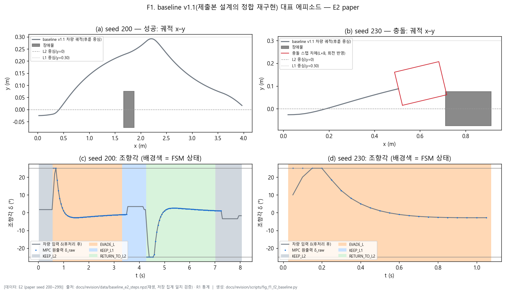
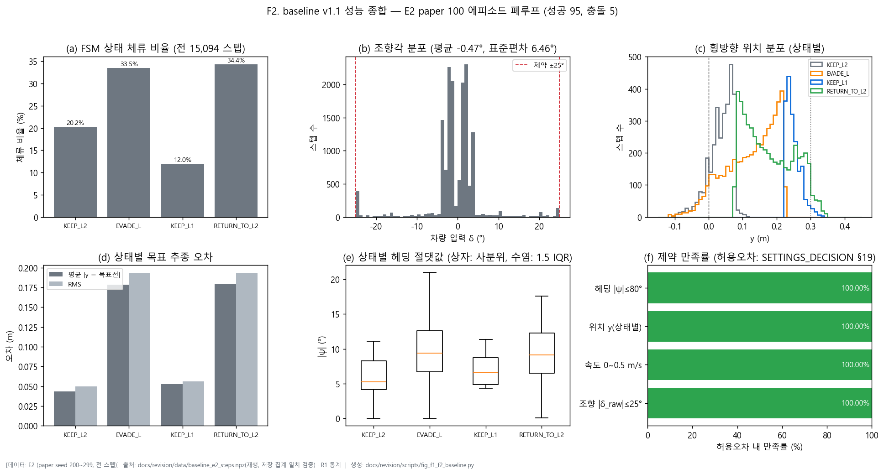
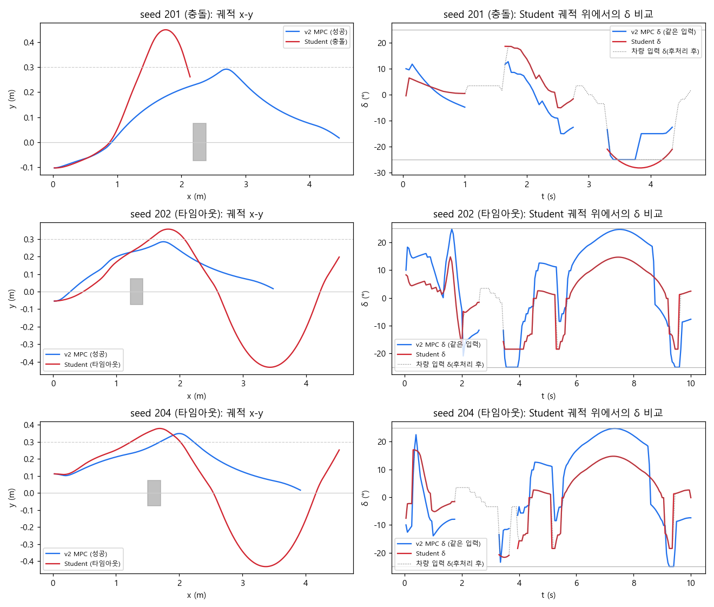
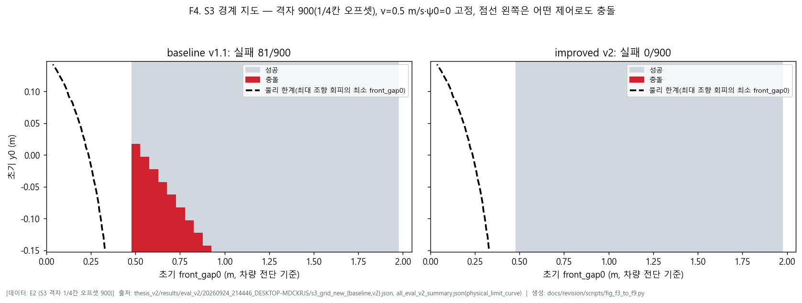
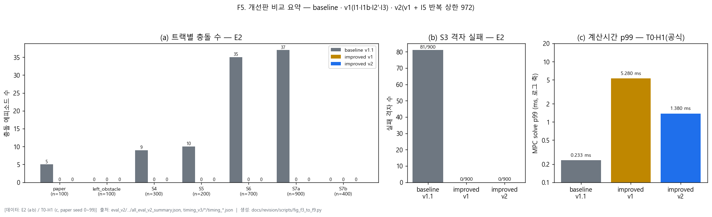
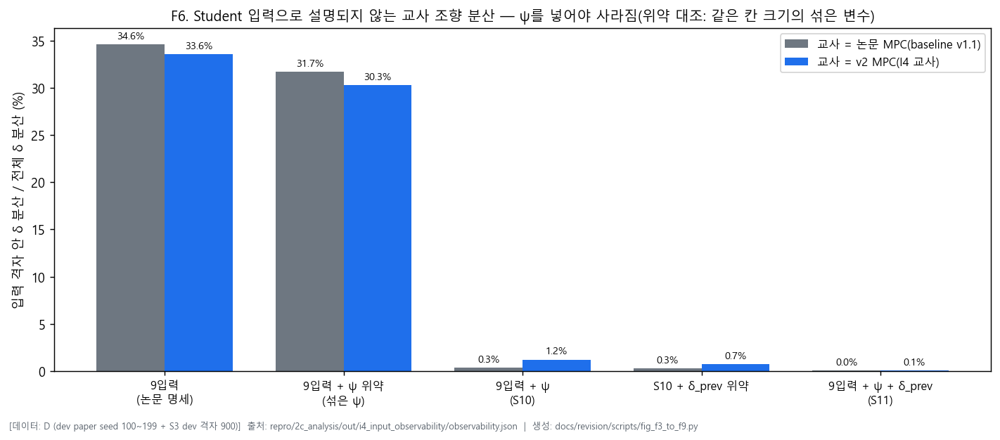
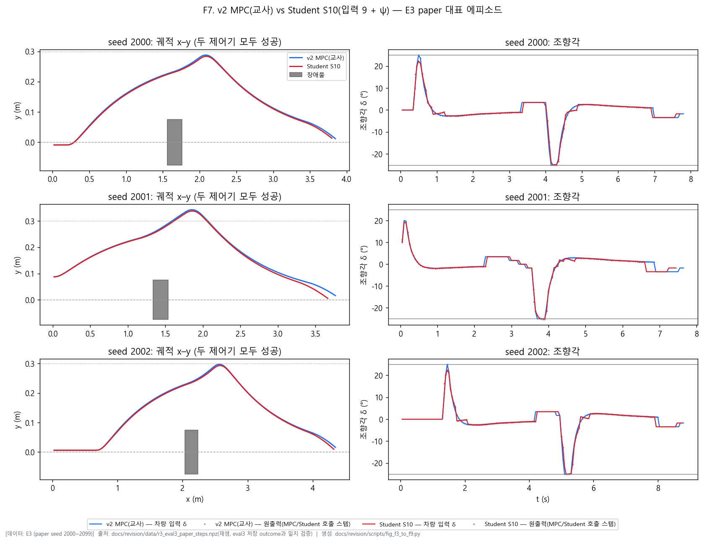
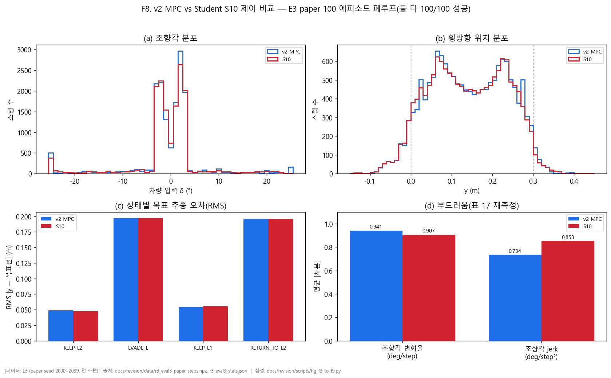
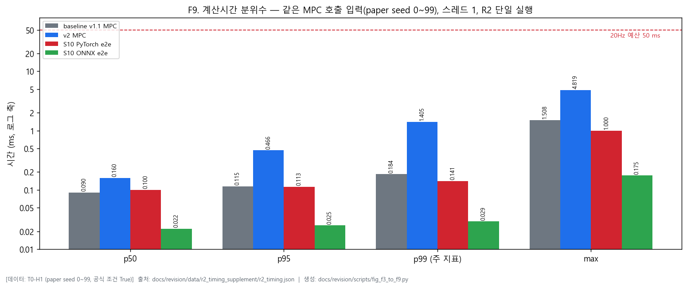

# 기술보고서 그림 캡션 (S3, 2026-09-25)

생성: `docs/revision/scripts/fig_f1_f2_baseline.py`, `fig_f3_to_f9.py`, 캡션: `make_captions.py`. 조건 코드는 부록 B (E2 = paper seed 200–299·S3 1/4칸 격자, E3 = paper seed 2000–2099·S3 3/4칸 격자, D = dev, T0-H1 = 계산시간 seed 0–99·공식 호스트).
재생 기반 그림(F1·F2·F7·F8)은 저장 결과와 일치 검증을 통과한 데이터만 사용(D9).

| 번호 | 제목 | 데이터 출처 | 조건 | 대표 에피소드 선택 규칙 | 대체 대상 |
|---|---|---|---|---|---|
| F1 | baseline v1.1 대표 에피소드 궤적·조향(성공 1, 충돌 1) | `docs/revision/data/baseline_e2_steps.npz(재생, 저장 집계 일치 검증) · R1 통계` | E2 (paper seed 200–299) | seed 오름차순 첫 성공(seed 200) + 첫 충돌(seed 230) | 제출본 그림 1(Teacher 궤적 예시 부분) |
| F2 | baseline v1.1 성능 종합(체류·조향·위치·추종 오차·헤딩·제약 만족) | `docs/revision/data/baseline_e2_steps.npz(재생, 저장 집계 일치 검증) · R1 통계` | E2 (paper seed 200–299, 전 스텝) | 선택 없음(전 에피소드·전 스텝) | 제출본 그림 2(MPC 성능 종합 분석) |
| F3 | 논문 입력(9차원) 그대로 재학습한 Student의 폐루프 실패 사례 vs 같은 seed v2 MPC | `repro/2c_analysis/out/i4_closed_loop_failure/ (i4_closed_loop_failure_analysis.py, 저장 결과와 outcome 일치 재생)` | E2 (paper seed 200–299) | seed 오름차순 첫 충돌(201) + 첫·둘째 타임아웃(202, 204) — I4 분석 시 사전 고정 | 없음(신설, VI.4) |
| F4 | S3 경계 지도와 물리 한계 — baseline v1.1 vs improved v2 | `thesis_v2/results/eval_v2/20260924_214446_DESKTOP-MDCKRJS/s3_grid_new_{baseline,v2}.json, all_eval_v2_summary.json(physical_limit_curve)` | E2 (S3 격자 1/4칸 오프셋 900) | 선택 없음(격자 전체) | 없음(신설, VI.5) — 기존 분석 그림(구 격자·3층PC104)을 E2로 다시 그림 |
| F5 | 개선판 비교 요약(baseline·v1·v2) — 충돌·S3 실패·계산시간 p99 | `eval_v2/.../all_eval_v2_summary.json, timing_v3/*/timing_*.json` | E2 (a·b) / T0-H1 (c, paper seed 0–99) | 선택 없음(전 에피소드) | 없음(신설, VI.6) |
| F6 | 입력 관측성 — 9입력 / +ψ / +ψ+δ_prev와 위약 대조 | `repro/2c_analysis/out/i4_input_observability/observability.json` | D (dev paper seed 100–199 + S3 dev 격자 900) | 선택 없음(dev MPC 호출 스텝 전체) | 없음(신설, VI.7 — [개정] 근거) |
| F7 | v2 MPC vs Student S10 궤적·조향(대표 3 에피소드) | `docs/revision/data/r3_eval3_paper_steps.npz(재생, eval3 저장 outcome과 일치 검증)` | E3 (paper seed 2000–2099) | eval3 seed 2000·2001·2002(처음 세 seed, 사전 고정) | 제출본 그림 1(Teacher–Student 궤적 비교 부분) |
| F8 | v2 MPC vs Student S10 제어 비교(조향 분포·위치 분포·추종 오차·부드러움) | `docs/revision/data/r3_eval3_paper_steps.npz, r3_eval3_stats.json` | E3 (paper seed 2000–2099, 전 스텝) | 선택 없음(전 에피소드·전 스텝) | 제출본 그림 3(Teacher와 Student 제어 비교, 학습 데이터 기반) — 폐루프 기반으로 대체 |
| F9 | 계산시간 분위수 — baseline MPC / v2 MPC / S10 PyTorch / S10 ONNX | `docs/revision/data/r2_timing_supplement/r2_timing.json` | T0-H1 (paper seed 0–99, 공식 조건 True) | 선택 없음(전 MPC 호출) | 제출본 표 16·18의 그림 대응(제출본에 해당 그림 없음 — 신설) |

## 그림별 캡션 전문

### F1. baseline v1.1 대표 에피소드 궤적·조향(성공 1, 충돌 1)

- 데이터 출처: `docs/revision/data/baseline_e2_steps.npz(재생, 저장 집계 일치 검증) · R1 통계`
- 조건 코드: E2 (paper seed 200–299)
- 대표 에피소드 선택 규칙: seed 오름차순 첫 성공(seed 200) + 첫 충돌(seed 230)
- 대체 대상: 제출본 그림 1(Teacher 궤적 예시 부분)
- 생성: `fig_f1_f2_baseline.py`
- 비고: 궤적은 후륜 중심. 충돌 패널(b)만 가로·세로 같은 축척으로 충돌 스텝의 차체(L×B, 헤딩 회전 반영)를 그림 — 충돌 판정은 차체 전단 기준(회전 사각형 겹침). 배경색은 FSM 상태.

### F2. baseline v1.1 성능 종합(체류·조향·위치·추종 오차·헤딩·제약 만족)

- 데이터 출처: `docs/revision/data/baseline_e2_steps.npz(재생, 저장 집계 일치 검증) · R1 통계`
- 조건 코드: E2 (paper seed 200–299, 전 스텝)
- 대표 에피소드 선택 규칙: 선택 없음(전 에피소드·전 스텝)
- 대체 대상: 제출본 그림 2(MPC 성능 종합 분석)
- 생성: `fig_f1_f2_baseline.py`
- 비고: 제출본 그림 2의 9개 패널 중 속도 분포는 규칙 기반 속도(0.5 m/s 상수, 첫 스텝만 v0)라 정보가 없어 제외하고 수치는 표 7로. 제약 만족 허용오차는 SETTINGS_DECISION §19 정정값.

### F3. 논문 입력(9차원) 그대로 재학습한 Student의 폐루프 실패 사례 vs 같은 seed v2 MPC

- 데이터 출처: `repro/2c_analysis/out/i4_closed_loop_failure/ (i4_closed_loop_failure_analysis.py, 저장 결과와 outcome 일치 재생)`
- 조건 코드: E2 (paper seed 200–299)
- 대표 에피소드 선택 규칙: seed 오름차순 첫 충돌(201) + 첫·둘째 타임아웃(202, 204) — I4 분석 시 사전 고정
- 대체 대상: 없음(신설, VI.4)
- 생성: `(재사용) repro/2c_analysis/i4_closed_loop_failure_analysis.py`
- 비고: 재사용 그림(생성 당시 캡션 없음). v2 MPC δ는 Student 궤적 위에서 같은 입력으로 그림자 호출한 값(조향에 쓰지 않음).

### F4. S3 경계 지도와 물리 한계 — baseline v1.1 vs improved v2

- 데이터 출처: `thesis_v2/results/eval_v2/20260924_214446_DESKTOP-MDCKRJS/s3_grid_new_{baseline,v2}.json, all_eval_v2_summary.json(physical_limit_curve)`
- 조건 코드: E2 (S3 격자 1/4칸 오프셋 900)
- 대표 에피소드 선택 규칙: 선택 없음(격자 전체)
- 대체 대상: 없음(신설, VI.5) — 기존 분석 그림(구 격자·3층PC104)을 E2로 다시 그림
- 생성: `fig_f3_to_f9.py`
- 비고: 기존 분석 그림(repro/2c_analysis/out/s3_with_physical_limit.png)은 구 격자·다른 호스트(3층PC104) 데이터이고 범례 색상표가 10색으로 잘못 표시돼 재사용하지 않고 E2 데이터로 다시 그림. 물리 한계 = 조향 최대 노력(bang-bang) 회피가 충돌하지 않는 최소 front_gap0.

### F5. 개선판 비교 요약(baseline·v1·v2) — 충돌·S3 실패·계산시간 p99

- 데이터 출처: `eval_v2/.../all_eval_v2_summary.json, timing_v3/*/timing_*.json`
- 조건 코드: E2 (a·b) / T0-H1 (c, paper seed 0–99)
- 대표 에피소드 선택 규칙: 선택 없음(전 에피소드)
- 대체 대상: 없음(신설, VI.6)
- 생성: `fig_f3_to_f9.py`
- 비고: (c)는 세 버전을 같은 날 같은 조건으로 잰 timing_v3 공식 측정. R2(표 8·18의 출처)는 baseline 0.184 / v2 1.405 ms — 1ms 미만 양의 p99는 실행 간 변동이 큼(RESULT_I4 §12-1).

### F6. 입력 관측성 — 9입력 / +ψ / +ψ+δ_prev와 위약 대조

- 데이터 출처: `repro/2c_analysis/out/i4_input_observability/observability.json`
- 조건 코드: D (dev paper seed 100–199 + S3 dev 격자 900)
- 대표 에피소드 선택 규칙: 선택 없음(dev MPC 호출 스텝 전체)
- 대체 대상: 없음(신설, VI.7 — [개정] 근거)
- 생성: `fig_f3_to_f9.py`
- 비고: 칸 크기: ey 0.01 m, front_gap 0.05 m, left_clear, 상태, ψ 1°, δ_prev 1°. 위약 = 같은 상태 안에서 섞은 ψ(δ_prev) — 칸을 잘게 나누는 것만의 효과를 분리.

### F7. v2 MPC vs Student S10 궤적·조향(대표 3 에피소드)

- 데이터 출처: `docs/revision/data/r3_eval3_paper_steps.npz(재생, eval3 저장 outcome과 일치 검증)`
- 조건 코드: E3 (paper seed 2000–2099)
- 대표 에피소드 선택 규칙: eval3 seed 2000·2001·2002(처음 세 seed, 사전 고정)
- 대체 대상: 제출본 그림 1(Teacher–Student 궤적 비교 부분)
- 생성: `fig_f3_to_f9.py`
- 비고: 원출력 점 = MPC(교사) 또는 Student가 호출된 스텝의 후처리 전 δ. 라인추종·SAFE_STOP 스텝은 두 제어기가 같은 규칙.

### F8. v2 MPC vs Student S10 제어 비교(조향 분포·위치 분포·추종 오차·부드러움)

- 데이터 출처: `docs/revision/data/r3_eval3_paper_steps.npz, r3_eval3_stats.json`
- 조건 코드: E3 (paper seed 2000–2099, 전 스텝)
- 대표 에피소드 선택 규칙: 선택 없음(전 에피소드·전 스텝)
- 대체 대상: 제출본 그림 3(Teacher와 Student 제어 비교, 학습 데이터 기반) — 폐루프 기반으로 대체
- 생성: `fig_f3_to_f9.py`
- 비고: 제출본 그림 3의 속도 패널은 제외(두 제어기 모두 규칙 기반 속도라 동일). (d)의 jerk는 조향각 2차 차분(제출본 표 17 라벨대로) — S10이 v2보다 16% 큼(불리한 방향 그대로 표시).

### F9. 계산시간 분위수 — baseline MPC / v2 MPC / S10 PyTorch / S10 ONNX

- 데이터 출처: `docs/revision/data/r2_timing_supplement/r2_timing.json`
- 조건 코드: T0-H1 (paper seed 0–99, 공식 조건 True)
- 대표 에피소드 선택 규칙: 선택 없음(전 MPC 호출)
- 대체 대상: 제출본 표 16·18의 그림 대응(제출본에 해당 그림 없음 — 신설)
- 생성: `fig_f3_to_f9.py`
- 비고: 원시 시간 배열이 저장되지 않아 분포 대신 분위수 막대. Student 시간은 정규화+추론+역정규화(e2e).
