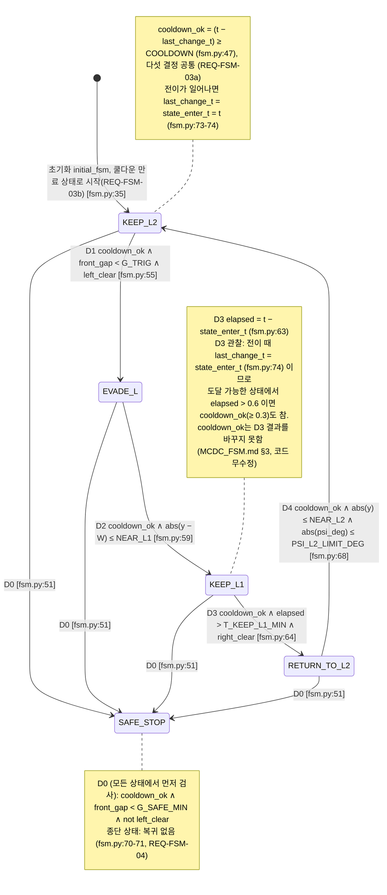
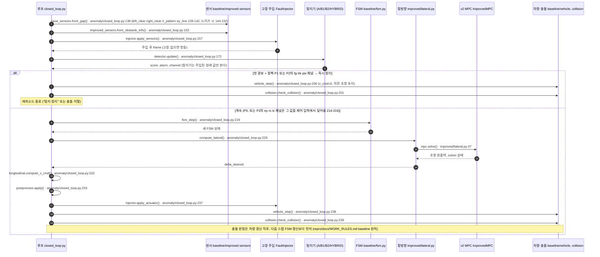
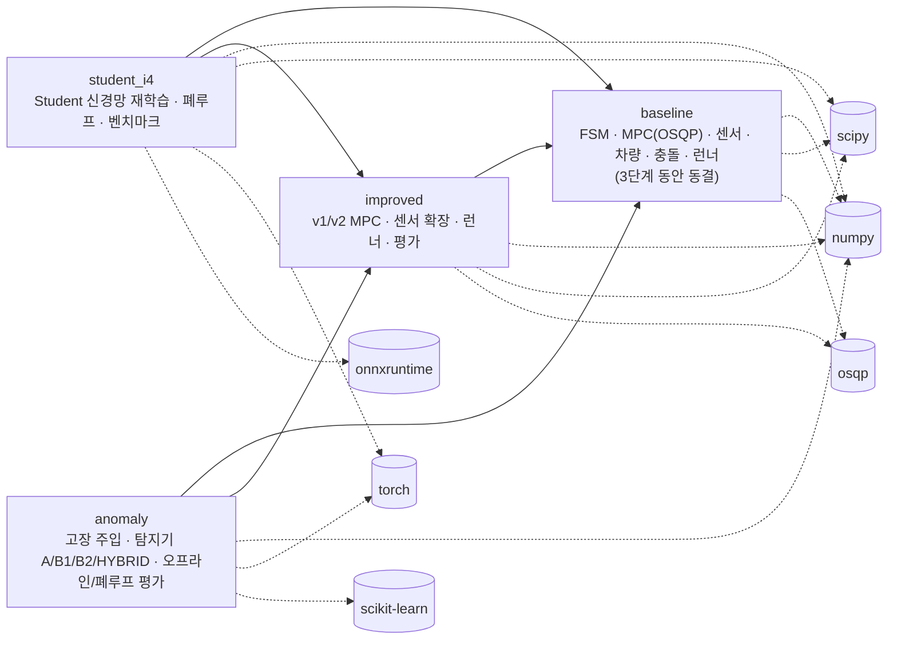

# UML — FSM 상태도 · 제어 1스텝 시퀀스도 · 컴포넌트도

기존 코드에서 **역으로** 그린 그림이다(설계 단계에서 먼저 그린 것이 아니다). GitHub Mermaid로 렌더링된다.
세 그림 모두 `check_uml.py`가 코드와 대조한다. 대조 항목은 각 절 끝에 적었다. 그림을 고치거나 코드가 바뀌면
`python docs/verification/aspice/check_uml.py`를 다시 돌린다. 불일치가 있으면 exit 1이다.

## 1. FSM 상태도 (`thesis_v2/baseline/fsm.py`)

<!-- uml:state -->

- 가드는 `fsm.py`의 조건식을 그대로 옮겼다. 상수는 `thesis_v2/baseline/config.py`의 값이다. G_TRIG=1.2, G_SAFE_MIN=0.20, COOLDOWN=0.3, W=0.30, NEAR_L1=0.08,
  NEAR_L2=0.08([개정]), T_KEEP_L1_MIN=0.6, PSI_L2_LIMIT_DEG=20.0이다(`config.py:16-27`).
- D0은 `if`, D1–D4는 `elif fsm.state == …` 사슬 안에 있다(`fsm.py:51-71`). 그래서 D0이 참이면 D1–D4는 평가되지 않는다. D0이 SAFE_STOP 자신에서 참이면 상태는
  그대로라서 전이로 기록되지 않는다(`fsm.py:73`). 그림에는 SAFE_STOP이 아닌 4개 상태에서 나가는 화살표로 그렸다.
- D0–D4 이름은 `docs/verification/MCDC_FSM.md`와 같다.
- **자동 대조**(`check_uml.py`):
  - 상태 집합이 `FSMState`와 같은지
  - 전이 집합(출발, 도착, 행)이 `fsm.py`를 AST로 읽은 결과와 같은지. 규칙: 상태 조건 없는 첫 `if`는 SAFE_STOP이 아닌 모든 상태에서의 전이로 펼치고, 초기 전이는 `initial_fsm`의 반환 행으로 본다.
  - 각 결정의 가드에 나오는 `config.*` 상수, `sensors.*` 필드, 지역 변수가 그 결정 ID(D0–D4)가 적힌 그림 행에 모두 있는지

## 2. 제어 1스텝 시퀀스도 (이상탐지 폐루프, `thesis_v2/anomaly/closed_loop.py`)

폐루프 평가(1,100회)에 쓰인 루프 `run_closed_loop_episode`(`closed_loop.py:94-289`)의 1스텝이다. 정책 P0이면 `anomaly/runner.py:run_episode`와 결과가 같다
(`closed_loop.py:16`). 그 런너는 이상탐지 확장이 없는 improved v2 루프와 golden 동치다(`anomaly/runner.py:10-11`).

<!-- uml:sequence -->

- 횡방향은 상태와 라인 감지 여부에 따라 라인추종 또는 MPC를 쓴다(REQ-LAT-01–05, `improved/lateral.py`). 그림의 `mpc.solve()`는 MPC 경로다. 라인추종 경로는 생략했다.
- 이탈 판정(`vehicle_off_road`, 240행)과 종료 판정(243-279행)은 시뮬레이션 쪽이라 생략했다.
- **자동 대조**(`check_uml.py`):
  - `호출() · 파일:행` 표기마다 그 행에 호출 이름이 실제로 있는지
  - `anomaly/closed_loop.py`의 행 번호가 그림 순서대로 증가하는지(실행 순서)
  - 조건 분기의 정확성(어떤 정책에서 어느 쪽으로 가는지)은 대조하지 않는다.

## 3. 컴포넌트도 (패키지 단위 import 그래프)

<!-- uml:component -->

- 실선 `A --> B`: 패키지 A의 모듈이 B를 import한다(`thesis_v2/<패키지>/`, tests 제외). `student_i4`는 `improved/student_i4/`를 따로 묶은 것이다.
  점선은 외부 라이브러리 import다(numpy, scipy, osqp, torch, sklearn, pandas, onnx, onnxruntime, matplotlib, joblib 중 실제로 import되는 것).
- baseline은 다른 내부 패키지를 import하지 않는다. 이것은 repro/docs/WORK_RULES.md의 "baseline 동결, 개선은 improved에서만"과 맞는다.
- **자동 대조**(`check_uml.py`): 그림의 실선 집합이 AST로 구한 패키지 import 그래프와 같은지, 점선 집합이 외부 라이브러리 import 집합과 같은지.
  그림에 없는 import가 생기거나 그림에만 있는 화살표가 있으면 실패한다.
